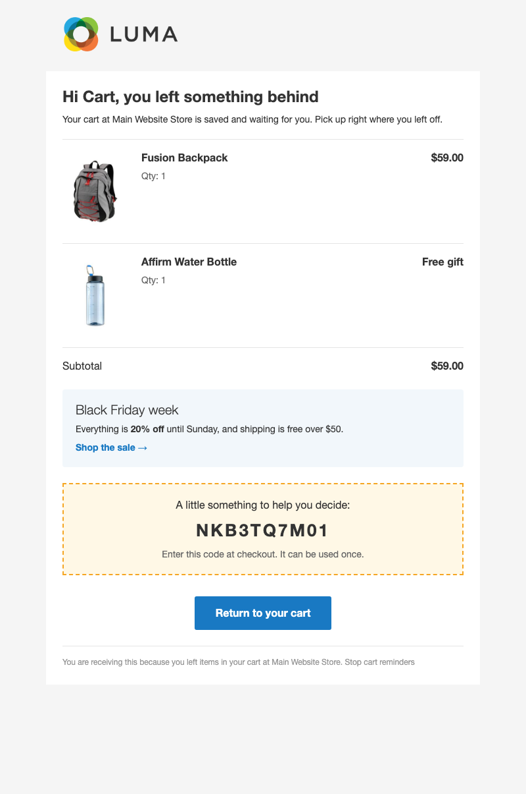

# Abandoned Cart Reminders for Magento 2

Win back shoppers who left items in their cart, with timed reminder emails, a one-click way back to the cart and an optional coupon.

Magento Open Source keeps abandoned carts and lists them under **Reports › Marketing › Abandoned Carts**, but it never emails anyone about them. This module adds the reminder emails, the "return to your cart" link, an optional single-use coupon and recovery tracking, and builds on core's carts and cart price rules.

## Features

- **Reminders on your schedule**: send up to as many reminders as you like, e.g. 1, 24 and 72 hours after the shopper last changed the cart. If cron was down and several reminders are overdue, the shopper gets one email, not a burst.
- **Guests and customers**: signed-in customers' carts qualify, and so do guest carts once the shopper has typed an email at checkout. No extra JavaScript is added.
- **One click back to the cart**: shoppers land in their restored cart with the coupon already applied. Customers with an account sign in first, because an email link never logs anyone in, and then go straight to their cart.
- **Coupon for the hesitant**: add a single-use code, generated from a cart price rule you choose, to a chosen reminder (by default the third). One coupon per email address, not one per cart.
- **Rich email**: product cards with image, name, quantity and row total, the cart subtotal, a highlighted coupon box and a **Return to your cart** button. Gifts from Tonyapps Free Gift show as *Free gift* instead of $0.00.
- **Promotion Block**: show a CMS block of your choice in the email (a banner, a current offer), edited with the normal WYSIWYG editor, per store view.
- **Respectful unsubscribe**: a "Stop cart reminders" link, plus one-click unsubscribe in Gmail and Apple Mail. An opt-out is remembered for that email address for good.
- **Safe from mail scanners**: link-checking robots that open every link can't apply the coupon, reset the schedule or unsubscribe anyone.
- **Recovery tracking**: a reminded cart that is later ordered is marked recovered. Carts whose email has already ordered since the cart last changed are not reminded.
- **Safe to switch on**: carts older than a set number of days (default 7) are ignored, so the first run doesn't email every old cart in the database.

## How it works

1. A shopper adds items and leaves. The cart stays in Magento as usual.
2. Every 15 minutes, cron checks for carts whose next reminder is due and emails them.
3. The shopper clicks **Return to your cart** and lands in the cart (guests) or on the sign-in page (customers), then checks out.
4. Placing the order marks the cart as recovered and stops further reminders.

## Screenshots

Emails as sent (Luma theme, 2026-11-09).

**Cart reminder with a coupon and the Promotion Block**



## Good to know

- Off by default. The reminder delays and maximum cart age are global settings; enable, sender, template, Promotion Block and coupon can be set per store.
- No admin report for recovered carts yet; recovery numbers are read from the database.
- Guest emails are captured on the standard Luma checkout. The guest's email is saved before the order is placed, which your privacy notice should mention.
- Requires Magento cron to be running.
- Built and tested on the Luma theme; Hyvä has not been checked.

## Requirements

- Magento Open Source 2.4.8
- PHP 8.3 or 8.4
- Magento modules: Quote, Checkout, SalesRule

## Installation

```sh
composer require tonyapps/module-abandoned-cart
bin/magento module:enable Tonyapps_AbandonedCart
bin/magento setup:upgrade
```

Make sure Magento cron is running.

## Configuration

- **Stores › Configuration › Sales › Abandoned Cart Reminders**: enable, delays (hours), cart age limit, sender, template, Promotion Block, coupon rule and which reminder carries the coupon.
- **Marketing › Cart Price Rules**: create the coupon rule with *Use Auto Generation* ticked and *Uses per Coupon* set to 1.
- **Content › Blocks**: create the block used as the Promotion Block.

### Redesigning the email

The email can be redesigned visually with the [Email Designer](https://github.com/tonyappsorg/magento2-email-designer) (`Tonyapps_EmailDesigner`): open **Marketing › Communications › Email Designer**, start a design for the email and save it, then pick the saved design in the **Template** setting under **Stores › Configuration**. The default template is used until a design is picked.

## For developers

Architecture, decisions, data model and tests are in [AGENTS.md](AGENTS.md).
